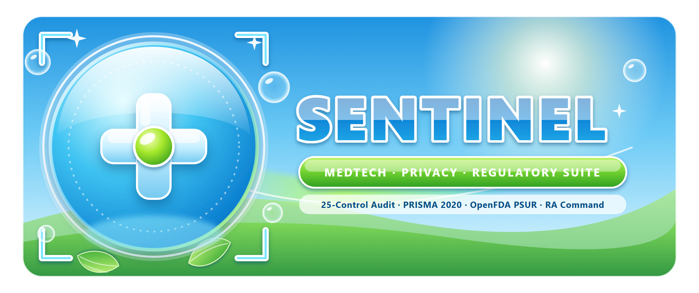

<div align="center">
  
</div>

# Unified MedTech, CRO & Digital Health Regulatory Compliance Suite

**End-to-End Automation for (1) External Digital Privacy, DMARC & Edge Cybersecurity (Swiss nFADP / EU GDPR / EU MDR Annex I GSPR 17.2) and (2) Clinical Evaluation Literature & PRISMA 2020 Evidence Synthesis (EU MDR Annex XIV / MEDDEV 2.7/1 Rev 4).**

[](https://www.python.org/)
[](https://opensource.org/licenses/MIT)
[](#architecture--dual-engine-design)
[-0F172A.svg)](https://kaledbouchagraoui7-bot.github.io/medtech-regulatory-compliance-suite/)

> **Executive Storefront & Scope Preview:** Explore fixed-scope 48h client deliverables, interactive DNS/MAUDE/PRISMA pre-checks, Design Partner Pilot intake, and bilingual legal copy at **[Executive Storefront, Live Pre-Check & Bilingual Terms (EN / FR)](https://kaledbouchagraoui7-bot.github.io/medtech-regulatory-compliance-suite/)**.

---

## Executive Overview

MedTech manufacturers, Software-as-a-Medical-Device (SaMD) companies, Clinical Research Organizations (CROs), and private healthcare groups in Switzerland and the EU face **two simultaneous regulatory bottlenecks**:

1. **Digital Privacy & Edge Cybersecurity (`Engine A — sentinel_scanner.py`)**: Under **Swiss nFADP (revDSG)**, **EU GDPR**, and **EU MDR Annex I GSPR 17.2 (IT Security)**, public web portals and corporate mail domains must prevent email/invoice spoofing (`DMARC`/`SPF`), block unconsented US IP transfers (`Google Fonts` / pre-consent trackers), enforce HTTP transport hardening (`HSTS`, `CSP`, `X-Frame-Options`), and comply with **European Accessibility Act (EAA / WCAG 2.1 AA)** standards.
2. **Clinical Evaluation & PRISMA 2020 Traceability (`Engine B — pilot_package_generator.py`)**: Under **EU MDR 2017/745 Annex XIV**, **MEDDEV 2.7/1 Rev 4**, and **Swiss MedDO**, regulatory writers must screen hundreds of PubMed/Embase abstracts and produce ALCOA+ traceable **PRISMA 2020 flowcharts**, **Vancouver-formatted Word evidence tables (`.docx`)**, and **filterable Excel screening matrices (`.xlsx`)**.

This repository combines both engines into a single CLI orchestrator ([`medtech_suite.py`](medtech_suite.py)) that generates a complete **Unified MedTech & CRO Compliance Dossier** in under 15 seconds.

---

## Architecture & Dual-Engine Design

| Module | Script | Core Capabilities | Generated Deliverables |
| :--- | :--- | :--- | :--- |
| **Engine A: Digital Privacy & Security Auditor** | [`sentinel_scanner.py`](sentinel_scanner.py) | 25 passive OSINT checks across 5 pillars: Email Anti-Spoofing (`DMARC`/`SPF`/`MX`/`CAA`), Swiss nFADP & GDPR Web Privacy (`Google Fonts` leak, trackers, cookies, privacy link), Edge Security (`TLS`, `HSTS`, `CSP`, `X-Frame-Options`, `nosniff`, `security.txt`), Accessibility (`WCAG 2.1 AA`), and Technical SEO/Schema.org. | • `<domain>_scorecard.png` & `.pdf` (300 DPI)<br>• `<domain>_executive_audit.docx` (Landscape)<br>• `<domain>_technical_findings.xlsx` (4 sheets)<br>• `remediation_configs/` (`_headers`, Nginx, DNS) |
| **Engine B: Clinical PRISMA 2020 Generator** | [`pilot_package_generator.py`](pilot_package_generator.py) | Strict mathematical PRISMA 2020 conservation accounting (`Identified - Duplicates = Screened = Excluded + Assessed`), automatic Vancouver reference formatting, and missing-DOI/conclusion QA flagging. | • `evidence_table.docx` (Landscape Word)<br>• `literature_screening.xlsx` (4 sheets)<br>• `prisma_flow_diagram.png` & `.pdf` (300 DPI) |
| **Engine C: RA Operations Command Center & Multi-Vertical Adapter** | [`ra_operations_command_center.py`](ra_operations_command_center.py) | Operationalizes 5 core Regulatory Affairs safeguards: (1) **Upstream SLA & Attribution Ledger** (tracking R&D/CMC/Clinical handoff deltas vs. RA review time), (2) **Multi-Agency Guidance Drift Radar** (FDA/EMA/MHRA/ICH/Swissmedic), (3) **Neutral Statutory Hold Certificate** (objective readiness scoring), (4) **Automated eCTD M1–M5 Cross-Check Linter** (catching N-count/lot/shelf-life discrepancies), and (5) **Workload Guardrail + Multi-Vertical Adapter** (`medtech_ra`, `ai_governance`, `fintech_dora`, `esg_csrd`). | • `<slug>_ra_command_brief.docx` (Landscape)<br>• `<slug>_ectd_crosscheck_and_sla.xlsx` (6 sheets)<br>• `<slug>_ra_control_dashboard.png` & `.pdf` (300 DPI)<br>• `<slug>_ra_command_package.zip` |
| **Combined Orchestrator** | [`medtech_suite.py`](medtech_suite.py) | Runs digital compliance, clinical PRISMA synthesis, and RA operations command center workflows from a single unified CLI. | • `00_Unified_Executive_Brief.docx`<br>• `01_Digital_Compliance_Audit/`<br>• `02_Clinical_PRISMA_Pilot/`<br>• `<slug>_unified_medtech_dossier.zip` |

---

## Quickstart

### 1. Install Dependencies

```bash
pip install -r requirements.txt
```

### 2. Run a Full Unified MedTech Dossier (Domain Audit + Clinical PRISMA Pilot)

```bash
python medtech_suite.py unified-dossier example-medtech.ch --records records.csv --config config.json --output-dir output
```

### 3. Run Either Engine Standalone

```bash
# Engine A only: Passive 25-control domain compliance & security audit
python medtech_suite.py audit-domain example-medtech.ch --output-dir output

# Engine B only: PRISMA 2020 clinical literature evidence package
python medtech_suite.py clinical-prisma --records records.csv --config config.json --output-dir output
```

### 4. Run the Automated QA Briefing & Outreach Dispatcher (`outreach_qa_dispatcher.py`)

Runs a **4-detector AI-text ensemble (`<10%` threshold)**, iterative stylometric humanizer loop, and B2B professionalism/UWG opt-out verifier before outputting Outlook `.eml` drafts (`X-Unsent: 1` with `.png` scorecards attached) or dispatching via throttled Outlook/Gmail SMTP:

```bash
# Safe Default: Verify <10% AI score + build ready-to-click Outlook .eml drafts
python outreach_qa_dispatcher.py --manifest manifest.csv --output-dir outreach_queue --dispatch draft

# Live Throttled Dispatch (requires SMTP_USER & SMTP_PASSWORD in environment/.env)
python outreach_qa_dispatcher.py --manifest manifest.csv --dispatch smtp --provider outlook --confirm-send --max-send 10
```

*(Note: Official REST API detectors `GPTZERO_API_KEY` and `SAPLING_API_KEY` are queried automatically alongside the 4 local stylometric detectors whenever configured in environment variables.)*

### 5. Run the Automated Test Suite

```bash
python -m unittest discover -p "test_*.py" -v
```

---

## Legal, Ethical & Regulatory QA Compliance

See [`LEGAL_COMPLIANCE_AND_ETHICS.md`](LEGAL_COMPLIANCE_AND_ETHICS.md) for the mandatory Swiss (`StGB Art. 143bis`, `UWG Art. 3(1)(o)`, `nFADP`, `MedDO`) and EU (`MDR 2017/745`, `GDPR`, `EAA`) legal, ethical, and human-in-the-loop QA rules.
